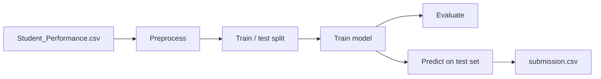

# 🎓 Student Performance Prediction

A machine learning project that predicts a student's **Performance Index** from their study habits and background, built as a modular Python pipeline with a companion exploration notebook.


**Contents:** [Overview](#-overview) · [Dataset](#-dataset) · [How it works](#-how-it-works) · [What I found](#-what-i-found) · [Structure](#-project-structure) · [Roadmap](#-roadmap)

---

## 🎯 Overview

Can a handful of everyday factors, such as how long a student studies, how much they sleep and how they scored before, predict how well they will perform? This project answers that with a regression model, and organises the code the way a real project would: separate modules for preprocessing, training and evaluation, plus a single entry point.

---

## 🗄️ Dataset

`Student_Performance.csv` has one row per student.

| Column | Type | Description |
|---|---|---|
| `Hours Studied` | Input | Hours the student studied |
| `Previous Scores` | Input | Scores from earlier exams |
| `Extracurricular Activities` | Input | Whether the student takes part (Yes / No) |
| `Sleep Hours` | Input | Average hours of sleep |
| `Sample Question Papers Practiced` | Input | Number of practice papers attempted |
| `Performance Index` | **Target** | Overall performance score to predict |

The dataset has no missing values, so no imputation was needed.

---

## ⚙️ How it works



1. **Preprocessing:** load the CSV, encode `Extracurricular Activities` from Yes/No to 1/0, separate the inputs from the target, and split into training and test sets.
2. **Training:** fit a Linear Regression model on the training data.
3. **Evaluation:** score the trained model.
4. **Submission:** predict on the held-out test set and save the results to `submission.csv`.

`main.py` ties these steps together, with each stage living in its own module inside `prediction/`.

---

## 💡 What I found

- A simple **Linear Regression** fits this data very well, which suggests the relationship between the inputs and the performance index is close to linear.
- Training and test scores are almost identical, so the model generalises instead of memorising the training data.
- The only preprocessing the data needed was encoding the single categorical column.

---

## 📁 Project structure

```
.
├── data/
│   └── Student_Performance.csv
├── prediction/
│   ├── data_preprocessing.py   # load, encode, split
│   ├── model_training.py       # fit the model
│   └── model_evaluation.py     # evaluate and write submission.csv
├── notebooks/
│   └── notebook.ipynb          # exploration and first model
├── main.py                     # runs the full pipeline
└── README.md
```

---

## 👤 Author

**Yadav Chandan** · [GitHub](https://github.com/yadavchandan26)

Feedback and suggestions are welcome.
